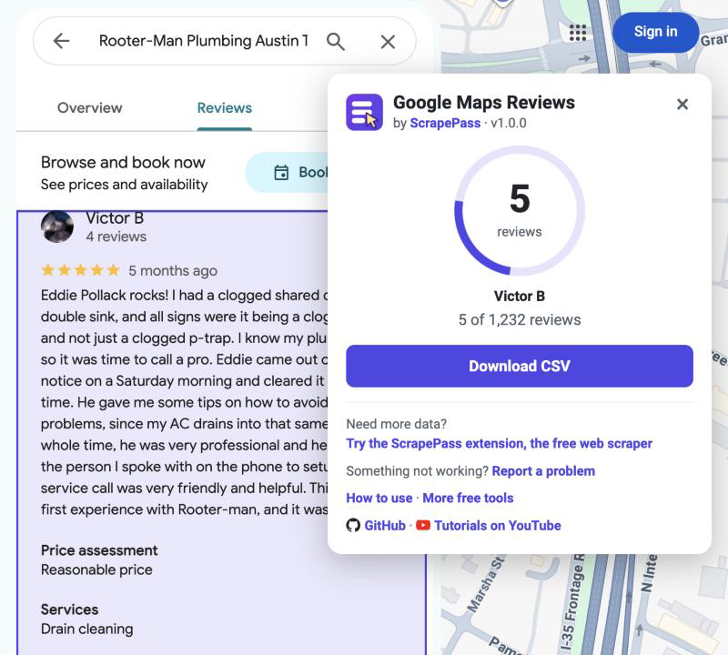

  

# ⭐ Google Maps Reviews Scraper One Click

**Free Google Maps reviews scraper in one bookmark.** Export every review of a place on Google Maps to a CSV file for
Excel or Google Sheets: reviewer, rating, date, the full text, extra details, likes, photos and the owner's response.
No sign-up, no install, no API key, and nothing is sent anywhere.

Ideal for reputation monitoring, competitor research and customer feedback analysis.

### [➕ Add the bookmark](#install)

[Tutorials on YouTube](https://www.youtube.com/@scrapepass) · [More free tools](https://scrapepass.com/free-tools) ·
[scrapepass.com](https://scrapepass.com/?utm_source=github&utm_medium=readme&utm_campaign=google-maps-reviews)

> **Need a more powerful tool?** [Try ScrapePass, the free web scraper →](https://scrapepass.com/?utm_source=github&utm_medium=readme&utm_campaign=google-maps-reviews)

---

## How it works

1. Sign in to Google and open a place on Google Maps, for example a restaurant or a plumber.
2. Click the **⭐ ScrapePass - Google Maps Reviews** bookmark. A small panel opens and asks **Ready?**
   To get the newest reviews first, choose **Sort → Newest** on the place's Reviews tab now.
3. Press **Go**. It opens the Reviews tab, scrolls through every review and opens each one's full text. A purple
   highlight moves down the reviews one by one, and the panel counts them: "120 of 1,232 reviews".
4. Press **Download CSV**. The file is named after the place, for example
   `ScrapePass Google Maps Reviews - Lone Star Plumbing Co.csv`.

## Install

You need a desktop browser with a bookmarks bar, such as Chrome, Edge or Brave. No bookmarks bar? Press
`Ctrl` + `Shift` + `B` (on a Mac, `⌘` + `Shift` + `B`).

### 1. From the web

Open **[➕ Add the bookmark](https://scrapepass.com/tools/google-maps-reviews-scraper#add-bookmark)** and drag the
**⭐ ScrapePass - Google Maps Reviews** button to your bookmarks bar. That's all. GitHub does not allow bookmark
buttons in READMEs, so the button lives on our website.

### 2. Manually, from the source on GitHub

The whole tool is one file, [`bookmarklet.js`](bookmarklet.js). Turn it into a bookmark yourself:

1. Open [`bookmarklet.js`](bookmarklet.js) and press **Copy raw file** (or open **Raw**, select all and copy).
2. Right-click your bookmarks bar and choose **Add page…** (Edge calls it the favorites bar).
3. Name it `⭐ ScrapePass - Google Maps Reviews`.
4. In the URL field, type `javascript:` and paste the code right after it, with no space in between.
5. Save.

The URL field joins the code into one line. That's expected: the code is written to run that way.

Either way, the bookmark only runs when you click it, and only on the Google Maps page you have open.

## What you get

One row per review:

| Column | What it holds | Example |
| --- | --- | --- |
| `place` | The place the reviews are for | Lone Star Plumbing Co. |
| `reviewer` | The reviewer's name | Jamie R. |
| `reviewer_info` | Local Guide badge, reviews and photos posted | Local Guide · 14 reviews |
| `rating` | Stars, from 1 to 5 | 5 |
| `date` | When it was posted, as Google Maps shows it | 3 months ago |
| `text` | The full review, with "More" opened | Fast, friendly and fixed the leak the same day… |
| `details` | Extra details the reviewer added | Services: Drain cleaning · Price assessment: Reasonable price |
| `likes` | How many people liked the review | 3 |
| `photos` | How many photos come with the review | 2 |
| `owner_response` | The owner's reply, when there is one | Thank you, Jamie, for the great review! |
| `owner_response_date` | When the owner replied | 2 months ago |
| `reviewer_url`, `place_url` | Links to the reviewer's profile and to the place | https://www.google.com/maps/contrib/… |

The examples are made up. The CSV is UTF-8 with a byte order mark, so accented letters show correctly in Excel.

## Privacy

Everything happens in your browser. The bookmark reads the reviews on the page you have open and builds the CSV
there. Nothing is sent to ScrapePass or anyone else, and the panel loads no images, fonts or scripts. The full source
code is in [`bookmarklet.js`](bookmarklet.js).

## FAQ

**Do I need to be signed in to Google?**
Yes. Signed out, Google Maps shows only five reviews of a place and asks you to sign in to see the rest.

**How many reviews can I get?**
Every review Google Maps shows for the place. It reads several reviews a second as Google loads them, so a place with
a thousand reviews takes a few minutes. Keep the tab open and in front, and press **Download CSV** any time to save
what it has so far.

**Can I export several places?**
Run the bookmark once on each place. Every row has the place's name and link, so the files combine into one
spreadsheet. To find places first, try the
[free Google Maps scraper](https://github.com/ScrapePass/google-maps-scraper-one-click).

**Does it work in other languages and countries?**
Yes, on Google Maps in any language and on any Google domain. Reviews come as Google Maps shows them.

**It stopped working. What now?**
Google Maps changes its page from time to time. Press **Report a problem** in the panel, or
[contact us](https://scrapepass.com/contact), with the place and a screenshot of the panel. Once it is fixed,
[add the bookmark](#install) again with the new `bookmarklet.js`: a bookmark keeps the code it was created with.

## Version

Current version: **1.0.0** (the `VERSION` line at the top of [`bookmarklet.js`](bookmarklet.js)). The panel shows
the version of your bookmark next to "by ScrapePass". If it is older, [add the bookmark](#install) again.

## Need a more powerful tool?

**[Try ScrapePass](https://scrapepass.com/?utm_source=github&utm_medium=readme&utm_campaign=google-maps-reviews)**,
the free web scraper for Chrome. It turns any web page into clean data, with prebuilt templates for Google Maps,
Amazon, Indeed and many more sites, and exports to Excel, CSV or JSON.

## Responsible use

Only collect data you have the right to use, and follow Google's terms and the privacy laws where you work. Reviews
are personal opinions written by people: handle reviewers' names with care.

## License

[MIT](LICENSE) © 2026 ScrapePass
